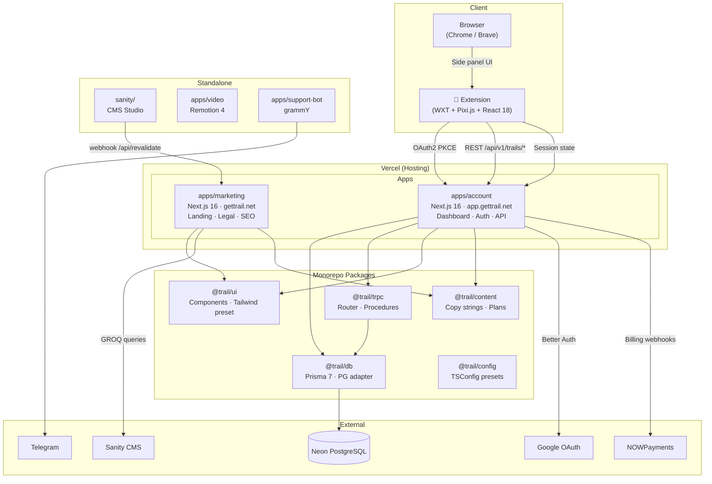
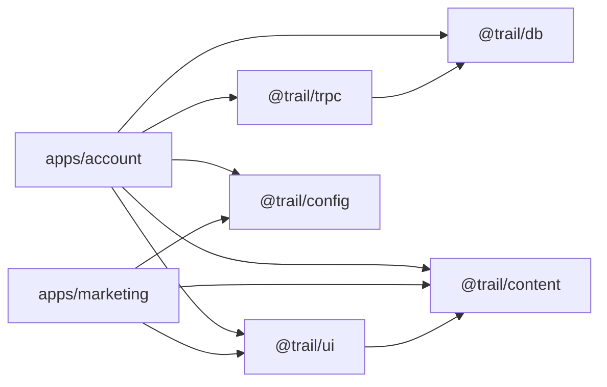
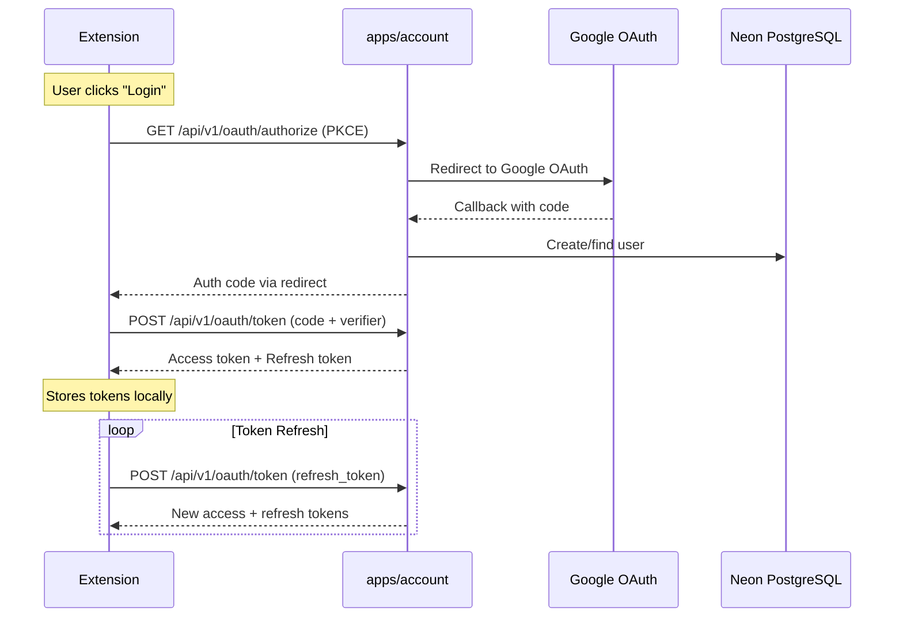
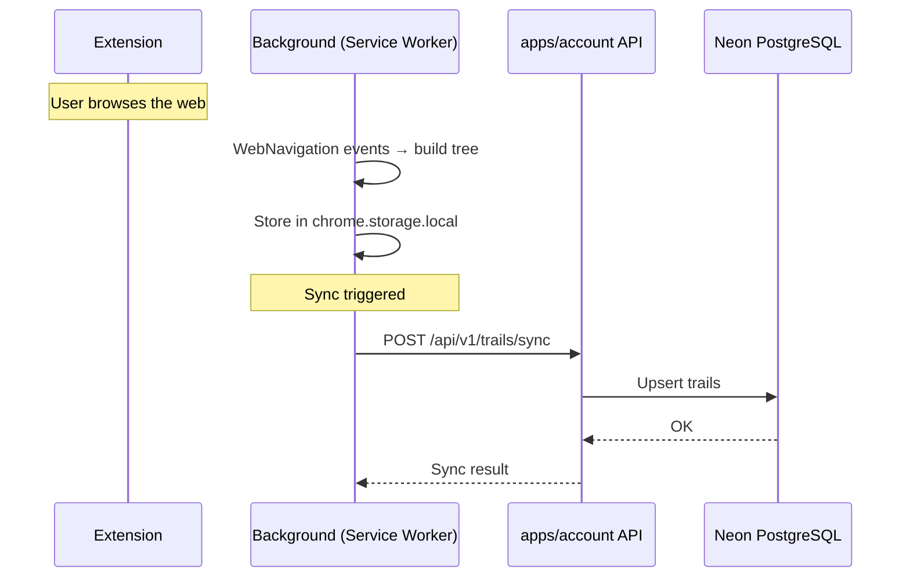
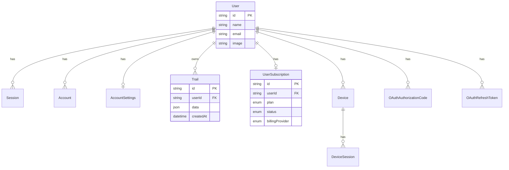

# Trail — Architecture Overview

## High-Level Diagram



## Services & Apps

### `apps/account` — Dashboard & API

| | |
|---|---|
| **URL** | `app.gettrail.net` |
| **Stack** | Next.js 16, React 19, Better Auth, tRPC, Prisma |
| **Port** | 4001 (dev) / 3001 (prod) |
| **Role** | User dashboard, auth provider, REST + tRPC API |

API surface:

```
/api/auth/[...all]          Better Auth (login, session, JWKS)
/api/trpc/[trpc]            tRPC endpoint
/api/v1/oauth/*             OAuth2 PKCE (authorize, token, revoke)
/api/v1/trails/*            Tree CRUD, sync, import, restore
/api/v1/subscription/*      Subscription lifecycle
/api/v1/billing/*           Portal, webhooks (NOWPayments)
/api/v1/account             Account info
/api/v1/auth/*              Session state, logout, bridge, portal
/api/v1/plans               Plan definitions
/api/v1/onboarding          Onboarding status
```

---

### `apps/marketing` — Landing Page

| | |
|---|---|
| **URL** | `gettrail.net` |
| **Stack** | Next.js 16, React 19, Three.js, Motion, Sanity client |
| **Port** | 3000 |
| **Role** | Landing page, legal pages (privacy, terms), SEO, OG |

Content is pulled from Sanity CMS via GROQ queries. Sanity webhook triggers `/api/revalidate` for ISR.

---

### `extension/` — Browser Extension

| | |
|---|---|
| **Stack** | WXT 0.20, Pixi.js 8, React 18, Zustand, MiniSearch |
| **Version** | 0.9.0 |
| **Role** | Visualize browsing history as interactive tree in side panel |

Separate pnpm workspace. Architecture:

```
extension/
├── entrypoints/
│   ├── background.ts          Service worker
│   ├── content.ts             Content script
│   └── sidepanel/             Side panel (React app)
├── src/
│   ├── background/
│   │   ├── services/          Auth, tree-storage, sync, quota, settings
│   │   ├── messaging/         RPC router + handlers
│   │   ├── navigation/        WebNavigation events
│   │   ├── state/             Background state
│   │   └── tabs/              Tab tracking
│   ├── content/               Content script logic
│   ├── shared/                Types, config, schemas
│   └── sidepanel/
│       ├── ui/                Components, graph renderer, hooks
│       └── api/               API layer
```

---

### `apps/video` — Demo Videos

Remotion 4.0 compositions for promo/demo videos.

### `apps/support-bot` — Telegram Bot

grammY-based support chat bot, deployed as standalone process.

### `sanity/` — CMS Studio

Sanity Studio for managing marketing content (hero sections, features, CTAs, site settings). Separate npm project.

---

## Shared Packages



| Package | Purpose |
|---|---|
| `@trail/db` | Prisma 7 client + PG adapter. Models: User, Session, Trail, Subscription, Device, OAuth tokens, etc. |
| `@trail/trpc` | Shared tRPC router, procedures, extension token signing (HMAC-SHA256 JWT) |
| `@trail/ui` | UI components (Button, Card, Badge…), marketing components (Nav, Footer, Pricing…), auth views, Tailwind preset, icons |
| `@trail/content` | Copy strings for marketing & account. Plan definitions (Free / Pro $8/mo / Teams $16/mo) |
| `@trail/config` | Shared `tsconfig.base.json` and `tsconfig.next.json` |

---

## Auth Flow



---

## Data Flow — Tree Sync



---

## Database Schema (key models)



---

## Infrastructure

```
┌─────────────────────────────────────────────────────┐
│                    GitHub Actions                     │
│  ci-web.yml          ci-extension.yml    neon.yml    │
│  typecheck + build   test + build      DB branches   │
└──────────┬──────────────────┬───────────────┬───────┘
           │                  │               │
     ┌─────▼─────┐    ┌──────▼──────┐  ┌─────▼─────┐
     │   Vercel   │    │ Chrome Web  │  │   Neon    │
     │  account   │    │   Store     │  │ PostgreSQL│
     │  marketing │    │  extension  │  │  (+ PR    │
     │            │    │             │  │  branches)│
     └────────────┘    └─────────────┘  └───────────┘
```

| Layer | Technology |
|---|---|
| Hosting | Vercel (web apps) |
| Database | Neon PostgreSQL (branch-per-PR in CI) |
| CMS | Sanity (studio + CDN) |
| Auth | Better Auth + Google OAuth |
| Payments | NOWPayments (crypto billing) |
| CI/CD | GitHub Actions |
| Local dev DB | Docker Compose (PostgreSQL 18) |
| Monorepo | pnpm workspaces |
| E2E tests | Cypress |
| Unit tests | Vitest |

---

## Subscription Plans

| Plan | Price | Limits |
|---|---|---|
| Free | $0 | Basic features |
| Pro | $8/mo · $72/yr | Full features |
| Teams | $16/mo · $144/yr | Multi-user |
